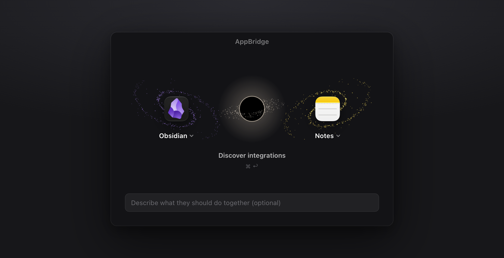

<div align="center">

# AppBridge

**Pick any two apps on your Mac. An AI agent figures out how they can talk to each other, then builds the bridge.**

[](#requirements)
[](#requirements)
[](https://claude.com/claude-code)
[](https://github.com/morluto/rea)



</div>

---

Most Mac apps were never designed to work together. AppBridge doesn't wait for an official integration. It sends
an agent to investigate both apps (scripting dictionaries, URL schemes, local data stores, and if that isn't
enough, the binaries themselves with [REA](https://github.com/morluto/rea) and Ghidra), then writes, tests and
saves a small adapter that moves data between them.

You review exactly what will change before anything happens. Once an adapter is saved, re-running it never calls
a model again.

## Quick start

```bash
git clone https://github.com/augustcomstock/appbridge.git
cd appbridge
npm install
npm start
```

Open **http://localhost:4317**, choose two apps, optionally describe what they should do together, and press
<kbd>⌘</kbd> <kbd>↩</kbd>.

## How it works

```
  Discover  →  Build  →  Preview  →  Run  →  Verify
```

1. **Discover.** The agent reads both apps without changing anything and streams back candidate integrations
   as it finds them, e.g. *"Export Obsidian notes into a Notes folder"*.
2. **Build.** For each candidate you pick, it writes an `adapter.mjs` with `plan`, `apply` and `verify`, tests it
   against synthetic fixtures, and does a read-only dry run.
3. **Preview.** `plan()` runs and you see how many items will be created, updated, skipped or deleted. Nothing
   has changed yet.
4. **Run.** After you approve, exactly the previewed items are applied. Deletes need a separate confirmation.
5. **Verify.** `verify()` re-reads the destination on its own and the result is logged.

## Why it's different

- **Works on apps with no API.** When conventional interfaces run out, the agent reverse engineers the app with
  REA and Ghidra to find where its data actually lives.
- **The output is code you keep.** Every integration is a plain executable adapter with its own tests, not a
  prompt you have to re-run.
- **Nothing happens without a preview.** You approve a concrete list of changes, and only that list is applied.
- **Honest labels.** An integration is marked "REA / Ghidra" only if reverse engineering tools actually ran for
  that pair. Otherwise it is labelled "Local", whatever the agent claims.
- **Local only.** The server listens on localhost, adapters have no network access, and there are no accounts.

## Safety

- Adapters run under `sandbox-exec`: no network, and file writes only to the paths the integration declares.
  `plan` and `verify` get no write access at all.
- The agent's shell runs inside Claude Code's OS sandbox and is instructed to inspect structure (schemas, key
  names, counts), not your content.
- By default adapters target dedicated test containers such as `~/AppBridge Test` or lists named
  "AppBridge Test".
- Password managers and credential stores are never offered as apps.

## Requirements

| | |
|---|---|
| macOS | Apple Silicon or Intel |
| Node.js | 22 or newer |
| Claude Code | installed and signed in (`claude auth login`); no API key needed |
| REA | `npm i -g rea-agents` |
| Ghidra | 12.1.x with JDK 21 |

Ghidra is found through `GHIDRA_INSTALL_DIR` or `~/.appbridge/tools/ghidra_*`, and Java through `JAVA_HOME` or
Homebrew's `openjdk@21`. On Apple Silicon, build Ghidra's native decompiler once:

```bash
support/gradle/gradlew buildNatives
```

## FAQ

<details>
<summary><b>Does it send my notes to a model?</b></summary>

The agent is told to look at structure, not content, and to never print credentials or tokens. Discovery
happens through Claude Code, so whatever it does read goes through your own Claude Code session. Running a
saved adapter involves no model at all.
</details>

<details>
<summary><b>Why Claude Code and not a Claude Desktop extension?</b></summary>

An MCP App inside Claude Desktop can only ask the chat to act, so the chat would have to be the coding agent,
limited to MCP tools. Claude Code is already a tool-calling coding runtime that speaks MCP to REA, needs no API
key, and can be driven and tested headlessly. The engine knows about neither, so it can be wrapped as an MCP
server later.
</details>

<details>
<summary><b>Can I watch what the agent is doing?</b></summary>

Press <kbd>`</kbd> in the window to show the transcript of the Claude Code session working on it. Full
transcripts, including every tool call, are also saved under `~/.appbridge/library/<pair>/agent-logs/`.
</details>

<details>
<summary><b>Does it keep apps in sync?</b></summary>

Not yet. Scheduling, continuous sync, cloud accounts and a "repair integration" flow are deliberately out of
scope for this proof of concept. Adapters track a source-to-destination mapping, so re-running one doesn't
create duplicates.
</details>

## Under the hood

| Part | Where | Role |
|---|---|---|
| Engine | `src/engine/` | App enumeration, integration library, sandboxed adapter runner. No UI or model dependency. |
| Agent | `src/engine/agent.mjs`, `prompts.mjs` | Headless Claude Code with REA attached over MCP. Used only to discover and build. |
| Server | `src/server.mjs` | Localhost-only HTTP and server-sent events between UI and engine. |
| UI | `public/` | Preact front end driven by live engine state. |

Everything AppBridge saves lives in `~/.appbridge/`:

```
library/<bundleA>__<bundleB>/
  notes.md                 findings shared across sessions
  discovery.jsonl          candidates from the latest discovery
  runs.jsonl               execution history
  agent-logs/              full agent transcripts (every tool call)
  <integration-id>/
    integration.json       identity, versions, directions, config, resources, validation, evidence, last run
    adapter.mjs            the reusable adapter
    adapter.test.mjs       its tests
    state.json             source-to-destination mapping used to prevent duplicates
```

## Development

```bash
npm test    # engine tests: sandbox, runner contract, candidate validation
```

<div align="center">
<sub>AppBridge is an early proof of concept. Point it at test data first.</sub>
</div>
